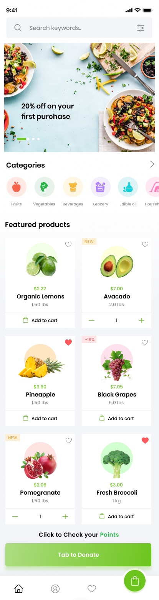
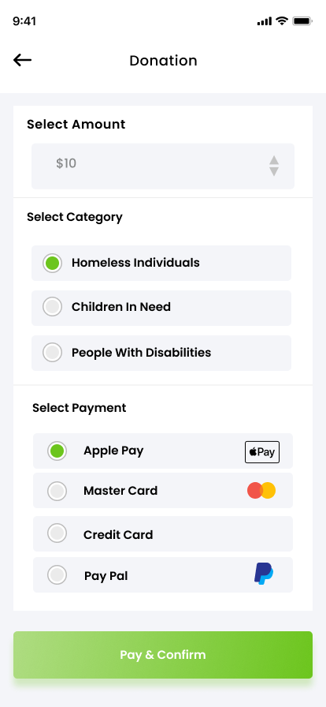
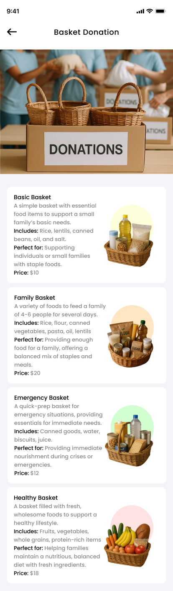

# FRESH Online Market

An interactive mobile prototype for grocery shopping and charitable giving. Shoppers can browse products, add items to a cart, and explore ways to donate groceries or money.

**[Try the interactive prototype in Figma →](https://www.figma.com/proto/kSmVyK2JddTcoGtPEaQqMQ/Grocery-App--Big-Cart---Community-?node-id=160-1559&starting-point-node-id=160%3A1559)**

## Prototype walkthrough

### 1. Browse groceries

The home screen introduces product categories and featured groceries, with a shortcut to the donation flow.

### 2. Make a donation

Shoppers can select an amount, choose a recipient category, and preview the payment step.

### 3. Explore donation baskets

The basket screen shows food bundles for different needs.

## My contribution

I helped build, test, and refine the interactive prototype in Figma.

The prototype uses sample content and simulated payments. **Design reference:** [Big Cart Grocery App on Figma Community](https://www.figma.com/design/gQOsHQcfrnGvOHcOHzMNwB/Grocery-App--Big-Cart---Community-?node-id=0-1).
